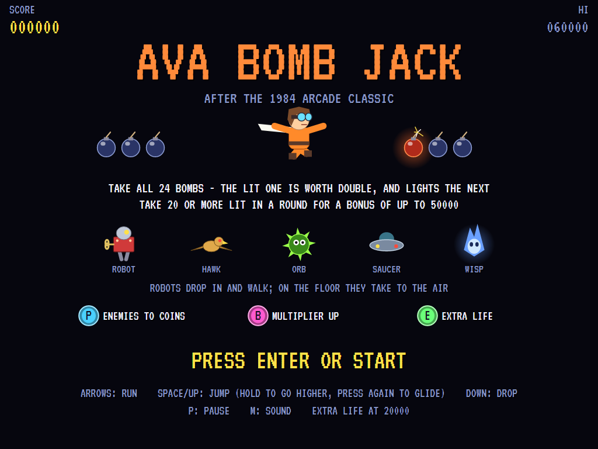
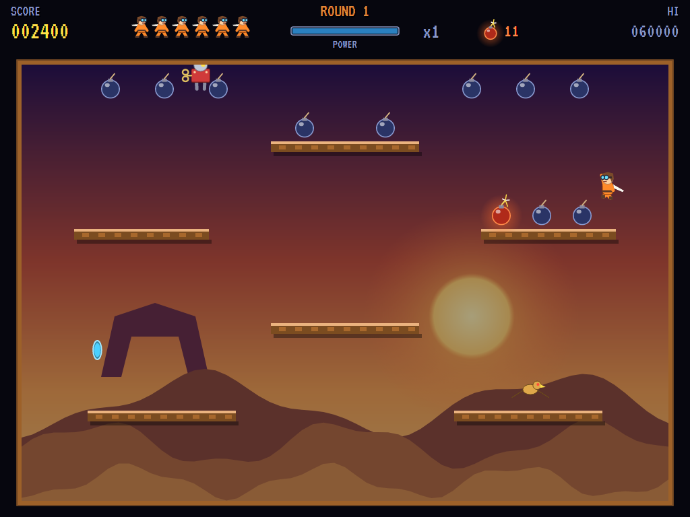
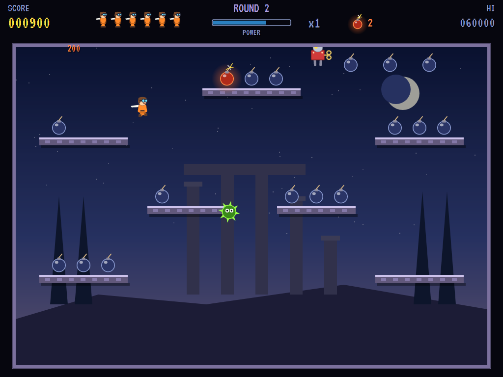
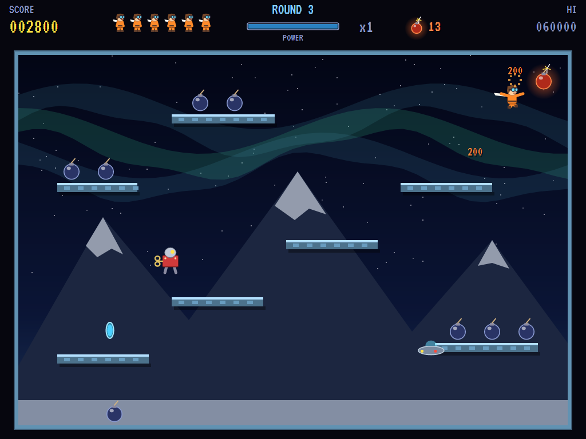
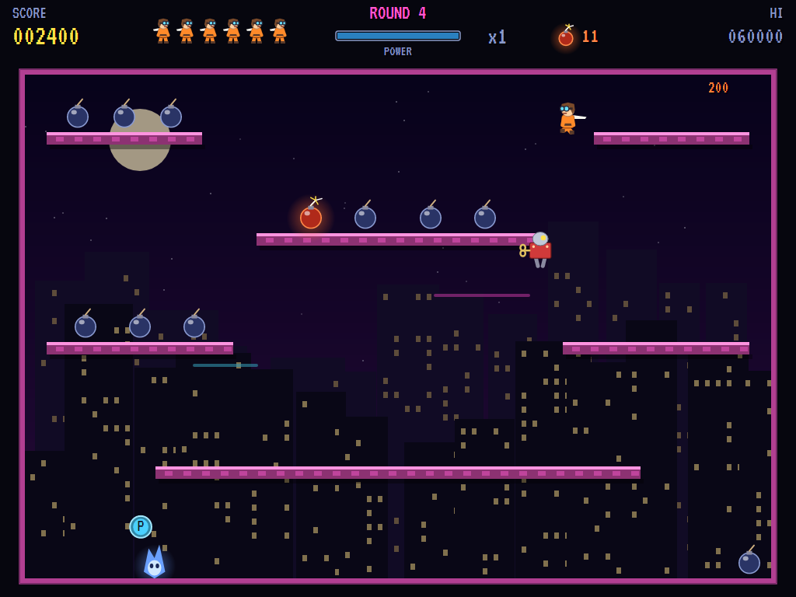
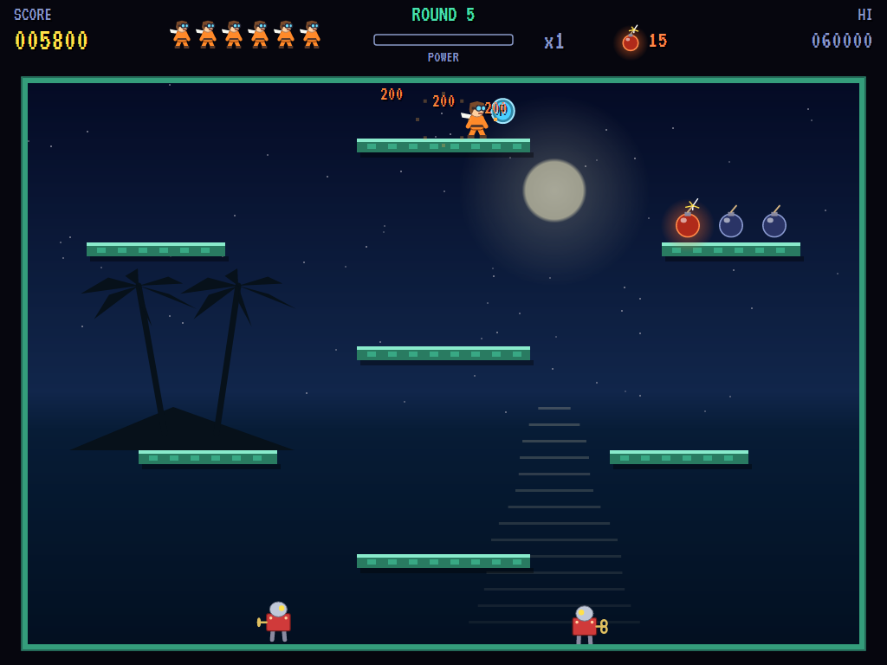
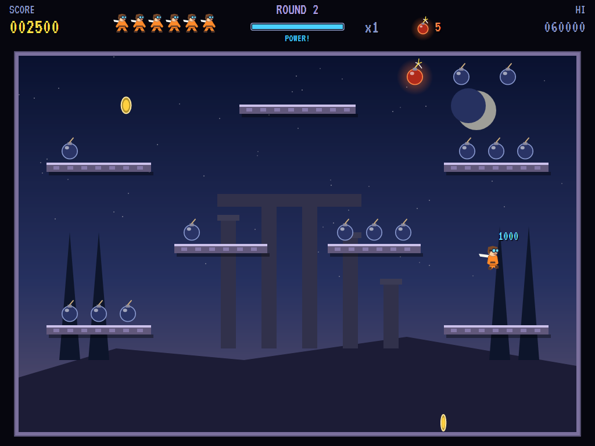
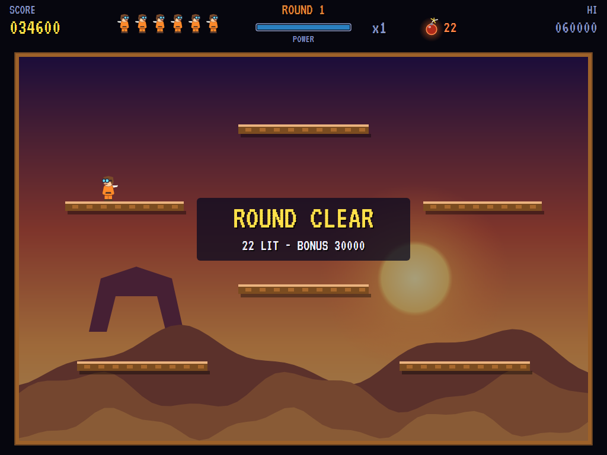
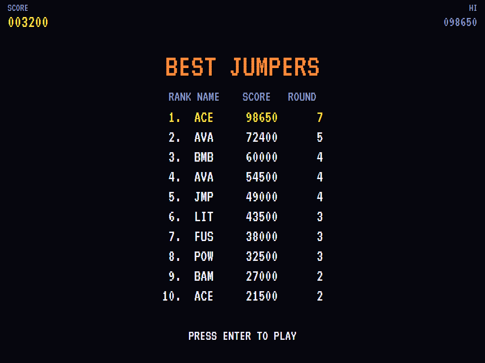

# AVA Bomb Jack

[](https://github.com/Harlock123/AVABombJack/actions/workflows/build.yml)

A bomb-collecting platform game in the style of Tecmo's 1984 arcade game **Bomb Jack**, built with .NET 10
and Avalonia UI. A jumper in goggles and a flying scarf leaps, glides and drifts around the screen,
gathering the 24 bombs in each round. Take one and the next in line lights up; take the lit ones and they
score double. Get 20 or more lit in a round for a big bonus. Wind-up robots drop in to stop you, and when
they reach the floor they take to the air.

## Features

- **The jumper**:
  - **Huge jumps:** a tap hops, and holding the button carries the jumper most of the way up the screen.
  - **Gliding:** a second press in the air, on the way down, glides it gently down for as long as it's held.
  - **Steering in the air:** it can be steered left and right the whole time, and Down drops it fast.
  - **Platforms** hold it up, and stop it from below too.
- **The bombs**: 24 in each round, on the platforms and in the air.
  - **The lit bomb:** taking any bomb lights the next one in the round's order. Take the lit one for 200
    (100 for an unlit one), and the one after that lights.
  - **The fire bonus:** take 20, 21, 22 or 23 lit in a round for a bonus of 10000, 20000, 30000 or 50000.
- **The enemies**:
  - **Robots**, wind-up tin soldiers, drop in from the top, walk the platforms and fall off the ends.
  - **Flyers:** on the floor a robot unfolds a pair of wings and takes to the air, as the round's flyer.
    - hawks that swoop at you
    - spiked orbs that bounce off the walls
    - saucers that slide across to get over you
    - wisps that gather speed until they burn out
  - **More of them**, and faster, each round.
- **The coins**: lettered coins that bounce about the screen until caught or gone.
  - **P (power):** comes out as the power meter fills from taking bombs (lit ones fill it faster). Catch it
    and every enemy turns into a gold coin for a few seconds, worth 100, 200, 300, 500, 800, 1200, then 2000
    each.
  - **B (bonus):** comes out every 10000 points and raises the score multiplier, up to ×5.
  - **E (extra):** comes out with every third P coin, for an extra life. There's an extra life at 20000 too.
- **Five rounds**, each a layout of its own with its own painted backdrop: the Dunes, the Ruins, the Frost
  Peaks, the Neon City and the Lagoon. After the fifth they come round again, with more and quicker enemies.
- **The attract mode** plays itself: a computer jumper that finds its way up past the platforms to the lit
  bomb, climbing in stages where it has to, and dodges what comes too close.
- **The sounds** are all synthesised: the spring of a jump, the chime of a lit bomb, the power fanfare, a
  bouncing round tune and the title march.

## Screenshots

| The title | The Dunes | The Ruins |
|:---------:|:---------:|:---------:|
|  |  |  |
| The jumper, the bombs and the enemies. | Round 1: robots, and a hawk. | Round 2: spiked orbs. |

| The Frost Peaks | The Neon City | The Lagoon |
|:---------------:|:-------------:|:----------:|
|  |  |  |
| Gliding under the aurora. | A wisp on the street. | A power coin in reach. |

| Power | A round cleared | The high scores |
|:-----:|:---------------:|:---------------:|
|  |  |  |
| The enemies turned to coins. | The bonus for the lit bombs. | The best jumpers. |

The screenshots are made by the tests, which play the game in a real (headless) window; see
[Tests](#tests).

## Download and run

Ready-to-run builds for Windows, macOS and Linux, on both Intel/AMD and ARM, are on the
[Releases page](https://github.com/Harlock123/AVABombJack/releases/tag/latest). **Latest build** is
rebuilt on every push to `main`. Each download is one self-contained executable: no .NET install is
needed.

| Platform | Archive |
|---|---|
| Windows | `AVABombJack-win-x64.zip`, `AVABombJack-win-x86.zip`, `AVABombJack-win-arm64.zip` |
| macOS | `AVABombJack-osx-arm64.tar.gz` (Apple silicon), `AVABombJack-osx-x64.tar.gz` (Intel) |
| Linux | `AVABombJack-linux-x64.tar.gz`, `AVABombJack-linux-arm64.tar.gz`, `AVABombJack-linux-arm.tar.gz` |

```bash
tar -xzf AVABombJack-linux-x64.tar.gz     # or linux-arm64, linux-arm, osx-arm64, osx-x64
./AVABombJack
```

On Windows, unzip and run `AVABombJack.exe`. On macOS, if Gatekeeper refuses to open it, run
`xattr -d com.apple.quarantine AVABombJack` once. Run with `--no-audio` for silence.

**Sound** comes through OpenAL Soft, built in for every platform. In a virtual machine the game
detects it and uses a larger audio buffer, so the sound doesn't break up.

**Gamepads** use SDL2, which is bundled for Windows, macOS and Intel/AMD Linux. ARM Linux builds need it
installed; without it the keyboard still works:

```bash
sudo apt install libsdl2-dev            # Debian / Ubuntu / Raspberry Pi OS
sudo pacman -S --needed sdl2-compat     # Arch / Omarchy
```

## Controls

| Input | Action |
|-------|--------|
| **Enter** | Start |
| **Arrow keys** / **W A S D** | Walk (diagonals too) |
| **Space** / **Z** / **X** / **Ctrl** | Shoot an arrow, the way you last walked (in a room) |
| **P** / **Esc** | Pause (Esc again to quit) |
| **M** | Mute |
| **Ctrl+S** / **Cmd+S** | Save a screenshot to the Pictures folder |

**Gamepad**: left stick or D-pad to walk, **A**, **B**, **X** or the right trigger to shoot, **Start** to
start and pause, **Back** (while paused) to quit.

**Entering initials**: type letters, or dial with **Up**/**Down** and accept with **Space**; **Left** /
**Backspace** go back; **Enter** finishes.

## Controls

| Action | Keyboard | Gamepad |
|---|---|---|
| Run | Left / Right (or A / D) | Left stick / D-pad |
| Jump (hold to go higher) | Space, Up, W, Z, X or Ctrl | A, B, X or D-pad up |
| Glide | Press jump again in the air, and hold | The same |
| Drop | Down (or S) | Down |
| Start | Enter | Start |
| Pause | P or Esc | Start |
| Sound on/off | M | |
| Screenshot | Ctrl+S (to your Pictures folder) | |

On the high-score table, type your initials, or use up/down and Space, then Enter.

## Tests

```bash
dotnet test AVABombJack.slnx
```

The engine has no UI and runs in fixed 60 Hz steps, so it plays the same at any frame rate, and a seed
always plays the same game. The tests check:

- **The jumper:**
  - running, and the frame
  - held jumps going higher than taps
  - gliding and dropping
  - landing on platforms and bumping them from below
  - walking off the end of one
- **The bombs:**
  - the next in order lighting, round the end too, and the lit one worth double
  - touching one to take it
  - the round's bonus for 20 or more lit, and on to the next layout
  - every layout's 24 bombs clear of its platforms
- **The coins:**
  - the power coin coming out
  - eating the enemies for more each time, and the power running out
  - the multiplier
  - bonus coins every 10000
  - extra-life coins every third power coin, and the life at 20000
  - coins bouncing then going
- **The enemies:**
  - robots dropping in, walking off the platforms and taking to the air on the floor
  - each round's flyer
  - more coming, up to the limit
  - wisps burning out
  - being caught (the bombs kept), a moment's safety, and the last life
- **The machine:** the attract cycle, the computer jumper clearing the first round, the same game from the same seed, and pausing

The screenshot tests draw the real screen in a headless window. To refresh the README's pictures:

```bash
BOMBJACK_SHOTS=$PWD/Images dotnet test tests/AVABombJack.Tests --filter ScreenshotTests
```

To see how the computer jumper gets on, round by round (for tuning):

```bash
BOMBJACK_PROBE=1 dotnet test tests/AVABombJack.Tests --filter PilotProbe --logger "console;verbosity=detailed"
```

## Building

```bash
dotnet build AVABombJack.slnx
dotnet run --project src/AVABombJack
```

Needs the .NET 10 SDK. The sounds are made by `tools/make_sounds.py` (standard-library Python):
`python3 tools/make_sounds.py` rewrites `src/AVABombJack/Sounds`.

## Project structure

```
AVABombJack/
├── AVABombJack.slnx
├── src/AVABombJack/
│   ├── Engine/
│   │   ├── GameEngine.cs        # States, the title and demo cycle, and the round music
│   │   ├── GameEngine.Play.cs   # Jumping, gliding and the platforms; bombs, coins and power; the
│   │   │                        # robots and flyers; rounds and scoring
│   │   ├── ShipPilot.cs         # The computer jumper, for the demonstration (and the tests)
│   │   ├── Entities.cs          # The five layouts and their bombs, and the jumper, enemies and coins
│   │   ├── HighScoreTable.cs, InitialsEntry.cs
│   │   ├── InputHandler.cs, ControllerManager.cs  # Keys and an SDL2 gamepad
│   │   └── SoundManager.cs      # Effects and the tunes through OpenAL
│   ├── Audio/                   # The OpenAL engine (from the author's AVABand)
│   ├── Views/                   # The backdrops, platforms, bombs, the jumper, the enemies and the screens
│   └── Sounds/                  # The synthesised effects and tunes
├── tests/AVABombJack.Tests/     # Gameplay, screenshot and probe tests
├── tools/make_sounds.py
└── Images/                      # Screenshots
```

## About and licence

AVA Bomb Jack © 2026 Lonnie Watson, under the [MIT License](LICENSE).

*Bomb Jack* © 1984 Tecmo (now Koei Tecmo); the name belongs to its current owner. AVA Bomb Jack is an
independent, unofficial game in its style. Its jumper, robots and flyers, its rounds and backdrops, its
graphics, sounds, tunes and code are its own; nothing is taken from the arcade machine's program, graphics,
sound or music. It is not affiliated with or endorsed by any rights holder.
